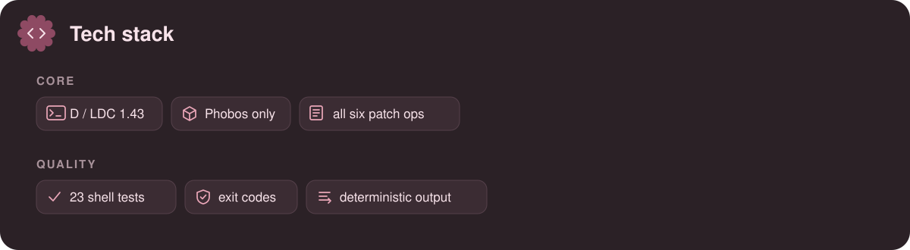

<p align="center">
  
</p>
<p align="center">
  <a href="https://github.com/Celine1337/d-jsonpatch/releases"></a>
  <a href="https://www.rfc-editor.org/rfc/rfc6902"></a>
  <a href="LICENSE"></a>
</p>


**d-jsonpatch** applies an [RFC 6902](https://www.rfc-editor.org/rfc/rfc6902) **JSON Patch** to a JSON document from the shell: `d-jsonpatch doc.json patch.json` runs the patch's operations in order and prints the resulting JSON. All six operations are supported — `add`, `remove`, `replace`, `move`, `copy` and `test` — with full JSON Pointer (RFC 6901) paths, including array indices, the `-` append token, and `~0`/`~1` escapes. Output is compact and deterministic: object keys are sorted, so identical input always yields byte-identical output.

Why D? Because Phobos ships a solid `std.json` (`JSONValue`, `parseJSON`) and the language compiles to a fast native binary via LDC — so a single `main.d` is a real, dependency-free JSON tool. No runtime to install, no external libraries, one build step.


- **All six RFC 6902 ops** — `add`, `remove`, `replace`, `move`, `copy`, `test`, applied in order.
- **Full JSON Pointer** — `""` for the root, `/a/b/0` for nested keys and array indices, `~1`→`/` and `~0`→`~`, and `-` to append to an array.
- **Safe `move`/`copy`** — values are deep-copied so operations never alias the source; moving a node into its own child is rejected.
- **Atomic failure** — a failed `test` or an invalid path prints an error to stderr and exits `1` **without** printing a partial result.
- **Deterministic output** — compact JSON with sorted object keys, reproducible across runs.
- **Strict validation** — array indices must be canonical (no leading zeros, in bounds); malformed patches are rejected.
- **Zero dependencies** — one D file using only Phobos; builds with LDC.
- **Tested** — a self-contained `test.sh` asserts exact outputs and exit codes.




Requires [LDC](https://github.com/ldc-developers/ldc) (the LLVM D compiler) with Phobos.

```bash
git clone https://github.com/Celine1337/d-jsonpatch.git
cd d-jsonpatch
./build.sh          # compiles to bin/d-jsonpatch
./bin/d-jsonpatch doc.json patch.json
```

Or compile directly:

```bash
ldc2 src/main.d -of=bin/d-jsonpatch -O
```


```bash
d-jsonpatch doc.json patch.json      # apply the patch, print the result
```

```text
$ cat doc.json
{"a":1,"arr":[1,2,3]}
$ cat patch.json
[{"op":"add","path":"/b","value":true},{"op":"remove","path":"/arr/0"}]
$ d-jsonpatch doc.json patch.json
{"a":1,"arr":[2,3],"b":true}
```

A failed `test` prints nothing to stdout and reports the failure on stderr:

```text
$ d-jsonpatch doc.json bad-test.json
d-jsonpatch: test failed at "/a"
```

Exit codes: `0` success, `1` failed test / invalid path / malformed JSON, `2` bad usage or unreadable file.


MIT — see [LICENSE](LICENSE).